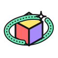
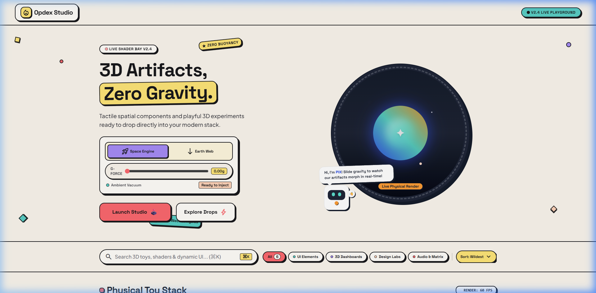
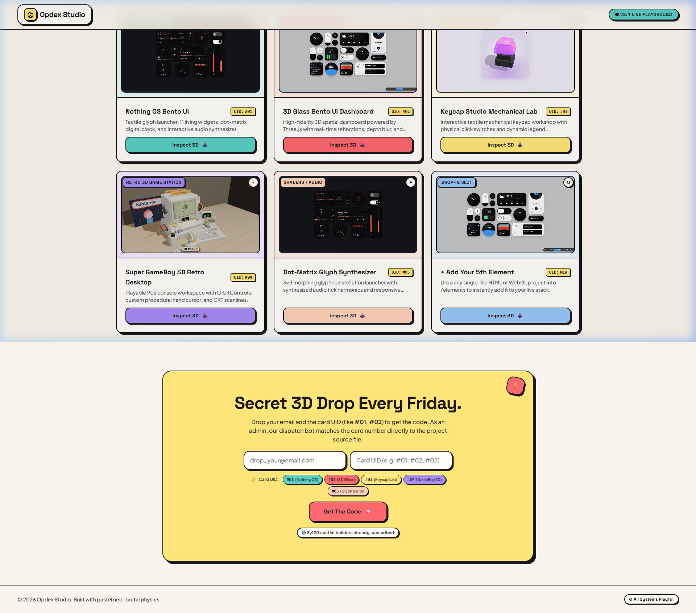

#  Opdex Studio · 3D Artifacts & Zero Gravity Interface

<p align="center">
  
</p>

<p align="center">
  <strong>A tactile WebGL & Neo-Brutalist frontend playground where 3D artifacts, spatial physics, and playful SaaS design collide.</strong>
</p>

<p align="center">
  
  
  
</p>

---

## ⚡ Why Opdex Studio?

Modern SaaS has become too sterile and predictable. **Opdex Studio** was built to bring back playfulness, tactile mass, and hardware engineering aesthetics to the web:

- **Tangible Digital Toys**: Web pages that feel like physical objects with spring mass, auditory clicks, and procedural lighting.
- **Zero-Gravity Physics**: Move beyond flat 2D layouts with interactive spatial WebGL, celestial gravity controls, and Three.js environments.
- **Drop-in Component Architecture**: Standalone, single-file HTML & WebGL modules ready to inject directly into modern web apps.

---

## 🧸 The 3D Artifacts Stack

<p align="center">
  
</p>

Every card represents a live, interactive 3D / WebGL laboratory:

- **UID `#01` · Nothing OS Bento UI**: 11 living widgets, dynamic Web Audio synthesizer, digital clock, compass, and 3x3 morphing glyph launcher.
- **UID `#02` · 3D Glass Bento UI Dashboard**: Three.js WebGL spatial dashboard with specular glass reflections and real-time telemetry.
- **UID `#03` · Keycap Studio Mechanical Lab**: Tactile mechanical keyboard switch designer with audio feedback and custom legends.
- **UID `#04` · Super GameBoy 3D Retro Desktop**: 90s console virtual workspace with OrbitControls, procedural hand cursor, and CRT scanlines.
- **UID `#05` · Dot-Matrix Glyph Synthesizer**: Procedural constellation audio-reactive matrix canvas.

---

## 🚀 SaaS Marketing Stunts

Opdex Studio integrates playful growth mechanics designed to maximize engagement and conversions:

1. **🌌 Celestial Zero-G Chamber & G-Force Slider**:
   Live orbital observation chamber with a rotating dashed ring, pulsing plasma orb, and a real-time gravity slider (`0.0G - 2.4G`) that alters scene physics on the fly.
2. **🤖 PIX Robot Mascot**:
   Autonomous robotic companion that reacts dynamically with contextual speech bubbles to user gravity adjustments.
3. **🏷️ Card UID Code Dispatch Terminal**:
   Users can request any project package simply by dropping their email and the Card UID (e.g. `#01`, `#02`). The admin dispatch engine matches the card number and instantly generates a verified tracking ticket with package manifest.
4. **📱 Multi-Device Inspection Sandbox**:
   One-click live modal to stress-test any 3D artifact in **Desktop**, **Tablet**, and **Mobile** viewports directly inside the landing page.

---

## 🤝 How to Contribute

We welcome creative developers, 3D artists, and shader enthusiasts to submit new interactive artifacts to the Opdex stack!

### Adding Your 3D Artifact:
1. **Fork & Branch**:
   ```bash
   git checkout -b feature/new-artifact
   ```
2. **Drop Your File**:
   Place your standalone HTML5 / WebGL / Three.js file into:
   ```text
   elements/my_artifact.html
   public/elements/my_artifact.html
   ```
3. **Add Preview & Register**:
   - Add a snapshot to `public/elements/thumbnails/my_artifact.png`
   - Register your artifact metadata and UID in `src/data/projects.ts`
4. **Open a PR**:
   Run `npm run build` to verify, commit your work, and open a Pull Request!

> **Looking for ideas?** We love WebGL shaders, retro console simulations, tactile sound generators, and physics toys.

