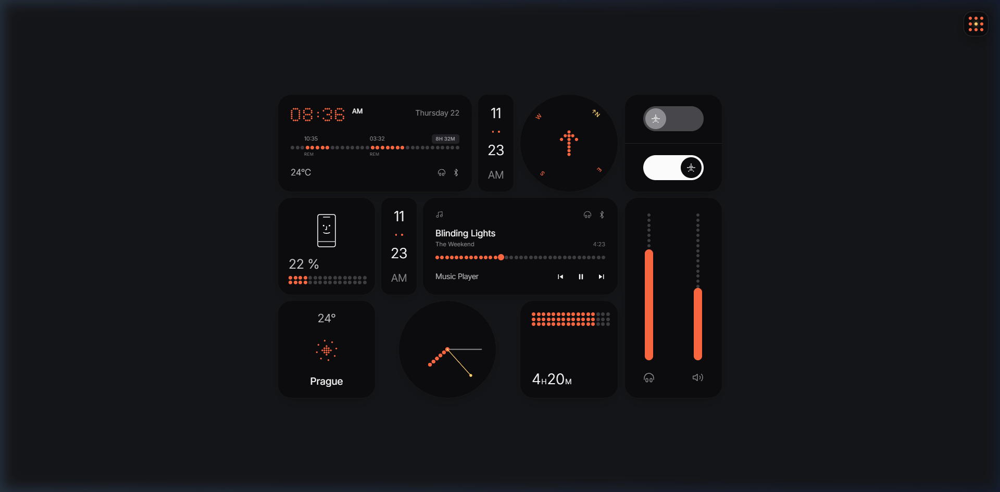

# 🪐 Opdex Studio · 3D Artifacts & Zero Gravity Interface

<p align="center">
  
</p>

<p align="center">
  <strong>A tactile WebGL & Neo-Brutalist frontend playground where 3D artifacts, spatial physics, and playful SaaS design collide.</strong>
</p>

<p align="center">
  <a href="#-about-opdex-studio"></a>
  <a href="#-tech-stack"></a>
  <a href="#-design-ui-system"></a>
  <a href="#-interactive-elements-lab"></a>
  <a href="#-saas-marketing-stunts"></a>
</p>

---

## 🌟 About Opdex Studio

**Opdex Studio** is a premier digital playground and component laboratory built for developers, designers, and creative technologists who are tired of sanitized, cookie-cutter SaaS templates. 

Inspired by the philosophy of **"Playful Tech"** and **"Tactile Hardware Interfaces"**, Opdex Studio turns flat web pages into tangible, physical toys. Every element is engineered to feel alive—with physical mass, reactive lighting, audio synthesis, and zero-gravity celestial mechanics.

From retro GameBoy simulations running on procedural hand pointers to Nothing OS dot-matrix telemetry widgets and Three.js specular glass dashboards, Opdex Studio bridges the gap between high-performance 3D WebGL and neo-brutalist interaction design.

---

## 🎨 The Design UI System: Pastel Neo-Brutalism

Opdex Studio is built upon a custom, handcrafted **Pastel Neo-Brutalist** design language ("Playful Tech Style" / "SaaS Illustration Design Style"). It combines the industrial toughness of brutalism with warm, approachable pastel tones and mechanical tactility.

### 1. High-Contrast Pastel Color Palette
| Color Name | Hex Code | Role & Usage |
| :--- | :--- | :--- |
| **Warm Cream Canvas** | `#FAF5EB` | Background foundation; evokes tactile textured paper |
| **Cream Card Surface** | `#FFFDF9` | Elevation cards with high legibility |
| **Sunshine Yellow** | `#FFE66D` | Primary action buttons, badges, and quadrant hero highlights |
| **Pastel Coral / Salmon** | `#FF6B6B` | High-impact callouts, alerts, avatar clusters, and accents |
| **Lavender Purple** | `#A78BFA` | Secondary buttons, celestial rings, and cosmic UI elements |
| **Mint Green** | `#6EE7B7` | Success indicators, live telemetry status, and active toggles |
| **Sky Blue** | `#60A5FA` | 3D glass widgets, link accents, and dimensional highlights |
| **Brutal Black** | `#18181B` | Deep structural borders, typography, and hard drop shadows |

### 2. Chunky Borders & Hard Offset Shadows
- **Solid 2.5px Borders**: Every interactive card, button, and input carries a crisp `2.5px solid #18181B` border.
- **Physical Hard Drop Shadows**: No blurry, ambient shadows. Opdex uses calculated hard offset shadows:
  - Default cards: `shadow-[6px_6px_0px_#18181B]`
  - Hero interactive containers: `shadow-[8px_8px_0px_#18181B]`
  - Buttons & badges: `shadow-[3px_3px_0px_#18181B]`
  - Pressed / Active state: Translates `translate-x-[2px] translate-y-[2px]` into `shadow-[1px_1px_0px_#18181B]` for authentic tactile actuation.

### 3. Tactile Dot-Grid Graph Texture
The canvas features a subtle, repeating radial dot grid (`radial-gradient(#18181B 1.2px, transparent 1.2px) 24px 24px`) that grounds every floating 3D component onto a hardware engineering workbench.

### 4. Dual-Font Typography Hierarchy
- **Space Grotesk** (`font-display`): Punchy, architectural, geometric display font used for oversized headings, numerical telemetry, badges, and technical readouts.
- **Plus Jakarta Sans** (`font-sans`): Ultra-clean modern humanist sans-serif providing crystal-clear readability for descriptions, metadata, and controls.
- **DM Mono** (`font-mono`): Monospace terminal logging and FPS counters.

### 5. Tangible Micro-Details
- **Mechanical Keycaps**: Tactile 3D keycaps (`[D]`, `[▲]`, `[◼]`, `[♥]`) with double-beveled borders and pressed spring mechanics.
- **Playful Angled Stickers**: Tilted badges (`-rotate-3`, `rotate-2`, `rotate-6`) that look like physical vinyl stickers slapped onto hardware.
- **Floating Starburst Sparkles (✦)**: Radiant vector sparkles providing whimsical micro-delight.

---

## 🚀 SaaS Marketing Stunts & Growth Mechanics

Opdex Studio integrates cutting-edge SaaS conversion tactics and viral marketing stunts engineered to turn casual visitors into active community members:

### 1. 🌌 The Zero Gravity Celestial Port & Live G-Force Console
Positioned as the centerpiece of the hero section, the **Celestial Zero-G Chamber** gives users hands-on control over the landing page's physics:
- **Interactive G-Force Slider**: Users can dynamically drag gravity from `0.0G (Zero-G Float)` to `2.4G (Hyper-G Density)`, watching the weight, bounce, and rotational speeds of floating artifacts adapt in real time.
- **Physics Engine Toggle**: Instant toggle between `Space Engine` (orbital inertia, weightlessness) and `Earth Web` (grounded Newtonian drag).
- **One-Click Presets**:
  - `Zero-G Orbit (0.0G)`: Total weightlessness with free-drifting cosmic dust.
  - `Lunar (0.16G)`: Low-gravity floating bounces.
  - `Hyper-G (2.4G)`: Crushing atmospheric density and rapid stabilization.
- **Dynamic Plasma Orb**: A glowing, morphing celestial core pulsing inside an orbiting dashed stellar ring.
- **PIX Mascot Interaction**: An autonomous robot companion ("PIX") hovering with dynamic contextual speech bubbles reacting to gravity adjustments.

### 2. 🧸 The "Physical Toy Stack" Live Artifact Showcase
Rather than boring static screenshots, the elements showcase treats digital projects as physical collectibles:
- Real rendered screenshots of live WebGL/HTML applications.
- Live hardware telemetry tags (`60 FPS`, `11 Widgets`, `Three.js / WebGL`).
- Direct action triggers: **"Inspect Live"** (opens multi-device viewport sandbox) and **"Launch Fullscreen"**.

### 3. 📱 Responsive Live Device Inspection Studio
A built-in modal sandbox allowing developers to stress-test any 3D artifact directly inside the landing page:
- **Viewport Switcher**: Instant switching between **Desktop (100%)**, **Tablet (768px)**, and **Mobile (420px)** frames.
- **Interactive Sandbox**: Full iframe isolation with live DOM interaction, audio playback, and gesture support.
- **1-Click Code Copy**: Instant developer utility to copy embed code directly into clipboard.

### 4. 💌 "Secret 3D Drop Every Friday" Lead Capture Engine
A high-converting viral email capture stunt designed with playful tech aesthetic:
- **Terminal Delivery Simulation**: `Terminal Delivery · 0 Spam` assurance pill.
- **Social Proof Counter**: Live social indicator (`Join 14,290+ devs and 3D designers`).
- **Interactive Instant Gratification**: Dynamic subscribe state that simulates a hardware terminal handshake upon submission.

---

## 🧪 Interactive Elements Lab

All interactive HTML applications are strictly organized in `elements/` and served through `public/elements/`:

| Artifact | Technology | Description |
| :--- | :--- | :--- |
| **[Nothing OS Dot-Matrix Bento UI](file:///d:/All%20About%20CODE/Project%20(mine)/Opdex%20Studio/elements/ox_ui.html)** | Canvas / Web Audio / Tailwind | 11 living widgets, interactive audio synth, digital clock, compass, music player, and 3x3 morphing glyph hamburger launcher. |
| **[3D Glass Bento UI Dashboard](file:///d:/All%20About%20CODE/Project%20(mine)/Opdex%20Studio/elements/Glass_widgets.html)** | Three.js / WebGL / CSS3D | Real-time dynamic light, specular reflections, tilt perspective, and glassmorphic card telemetry. |
| **[Keycap Studio Mechanical Lab](file:///d:/All%20About%20CODE/Project%20(mine)/Opdex%20Studio/elements/Keycap%20Studio.html)** | Bricolage Grotesque / Web Audio | Tactile mechanical keycap designer with acoustic click switches, dynamic legend styling, and reactive theme palettes. |
| **[Super GameBoy 3D Retro Desktop](file:///d:/All%20About%20CODE/Project%20(mine)/Opdex%20Studio/elements/retro_desktop.html)** | Three.js / GSAP / Canvas | Playable 90s console workspace with OrbitControls, procedural animated hand pointer, and CRT scanlines. |

---

## 📁 Repository Architecture

```text
Opdex Studio/
├── elements/                        # 🔒 Pure source HTML/3D artifacts (cleanly isolated)
│   ├── ox_ui.html                   # Nothing OS Dot-Matrix Bento UI
│   ├── Glass_widgets.html           # 3D Glass Bento UI Dashboard
│   ├── Keycap Studio.html           # Keycap Studio Mechanical Lab
│   └── retro_desktop.html           # Super GameBoy 3D Retro Desktop
│
├── public/
│   └── elements/                    # Web-accessible sandbox elements & previews
│       ├── ox_ui.html
│       ├── Glass_widgets.html
│       ├── Keycap Studio.html
│       ├── retro_desktop.html
│       └── thumbnails/              # High-fidelity rendered screenshots
│           ├── ox_ui.png
│           ├── glass_widgets.png
│           ├── keycap_studio.png
│           └── retro_desktop.png
│
├── src/
│   ├── app/
│   │   ├── layout.tsx               # Global root layout with Space Grotesk & Plus Jakarta fonts
│   │   ├── page.tsx                 # Full Neo-Brutalist landing page & Zero-G hero
│   │   └── globals.css              # Custom Neo-Brutalist utility classes & animations
│   ├── components/
│   │   ├── elements/                # Live interactive 3D components
│   │   │   └── Interactive3DCube.tsx
│   │   └── AddProjectModal.tsx      # Multi-device viewport testing studio
│   └── data/
│       └── projects.ts              # Registry of all 3D artifacts and telemetry
│
├── tailwind.config.ts               # Custom tokens: pastel palette, 2.5px borders, hard shadows
├── tsconfig.json                    # Strict TypeScript configuration
├── package.json                     # Next.js 15, React 19, Lucide React, Canvas Confetti
└── README.md                        # Documentation
```

---

## ⚡ Adding New 3D Elements in Seconds

Adding a new HTML/3D project to Opdex Studio requires zero framework rewrite:

1. **Place your HTML file** in both `elements/` (source) and `public/elements/` (live serving):
   ```bash
   elements/my_awesome_shader.html
   public/elements/my_awesome_shader.html
   ```

2. **Add a thumbnail screenshot** to `public/elements/thumbnails/my_awesome_shader.png`.

3. **Register the metadata** in `src/data/projects.ts`:
   ```ts
   {
     id: "my-shader",
     title: "Quantum Shader Sandbox",
     shortTitle: "Quantum Shader",
     tagline: "Real-time raymarched fractal explorer",
     category: "Shader Lab",
     description: "Interactive raymarched 4D fractals with GLSL audio reactivity.",
     path: "/elements/my_awesome_shader.html",
     tags: ["WebGL", "GLSL", "Raymarching"],
     themeColor: "#FF6B6B",
     badgeColor: "#FFE66D",
     icon: "sparkles",
     featured: true,
     stats: {
       fps: "60 FPS",
       tech: "Three.js / GLSL",
     },
   }
   ```
   *The element automatically mounts onto the Physical Toy Stack, search filters, and device inspection modal!*

---

## 🛠 Tech Stack

- **Framework**: [Next.js 15](https://nextjs.org/) (App Router, Turbopack, Fast Refresh)
- **Language**: [TypeScript](https://www.typescriptlang.org/) (Strict typing throughout)
- **Styling**: [Tailwind CSS](https://tailwindcss.com/) with customized Neo-Brutalist tokens
- **Icons**: [Lucide React](https://lucide.dev/)
- **Micro-Interactions**: [Canvas Confetti](https://www.npmjs.com/package/canvas-confetti)
- **Typography**: Google Fonts via `next/font/google` ([Space Grotesk](https://fonts.google.com/specimen/Space+Grotesk) & [Plus Jakarta Sans](https://fonts.google.com/specimen/Plus+Jakarta+Sans))
- **3D Engines (Labs)**: [Three.js](https://threejs.org/), WebGL, CSS 3D Transforms, Web Audio API

---

## 🚀 Getting Started

### Prerequisites
- Node.js 18.17 or higher
- npm 9+ or pnpm / yarn

### Installation
```bash
# Clone the repository
git clone https://github.com/mdjameee400/opdex_studio.git

# Navigate to project folder
cd opdex_studio

# Install dependencies
npm install

# Start development server
npm run dev
```

Visit [http://localhost:3000](http://localhost:3000) in your browser to experience Opdex Studio in real time.

### Building for Production
```bash
# Build optimized bundle
npm run build

# Start production server
npm run start
```

---

## 📜 License

Created with ❤️ by **Opdex Studio**. Built for makers, designers, and the future of playful digital hardware interfaces.
